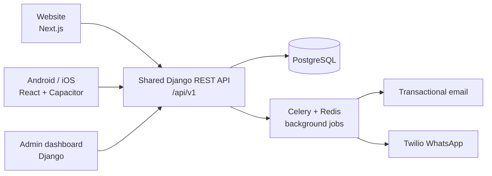
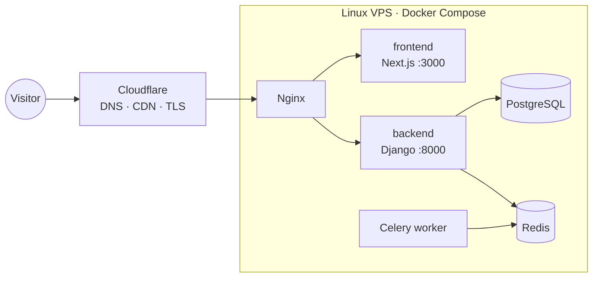
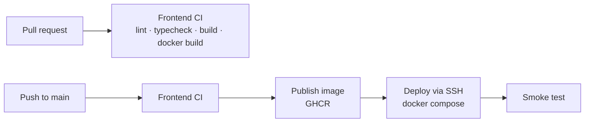

# Driveo Exclusive — Car Rental & Chauffeur Booking Platform

Driveo Exclusive Limited offers fixed-price private chauffeur travel in **London, Paris, Bulgaria and Dubai**.
This repository holds the platform that will replace the Lovable prototype. It has four parts:

- a premium, multilingual **website**
- **Android and iOS apps**
- a **shared Django API**
- an **admin dashboard**, from which the team manages vehicles, pricing, availability, customers and requests

> **Living document.** Update this README in the same change as the code it describes.
> See [Keeping this README current](#keeping-this-readme-current).
>
> **New to the project?** Start with [`project_context.md`](project_context.md). It covers the business,
> goals, plan, work objectives, progress, risks and open questions in one place.

---

## Contents

- [Project status](#project-status)
- [Repository layout](#repository-layout)
- [Architecture](#architecture)
- [Technology stack](#technology-stack)
- [Getting started](#getting-started)
- [Configuration](#configuration)
- [Domain model](#domain-model)
- [API contract](#api-contract)
- [Booking and notification workflow](#booking-and-notification-workflow)
- [Deployment](#deployment)
- [Development workflow](#development-workflow)
- [Decision log](#decision-log)
- [Open questions](#open-questions)
- [Changelog](#changelog)
- [Keeping this README current](#keeping-this-readme-current)

---

## Project status

_Last updated: 2026-10-22_

| Component | Directory | Stack | Status |
| --- | --- | --- | --- |
| Website | [`frontend/`](frontend/) | Next.js · React · TypeScript · Tailwind · GSAP | 🟡 In progress: home page complete, quote form on mock API |
| Shared API + admin | `backend/` _(planned)_ | Python · Django · DRF · PostgreSQL · Redis · Celery | ⚪ Not started |
| Mobile apps | `mobile/` _(planned)_ | React · Vite · TypeScript · Capacitor | ⚪ Not started |
| Infrastructure | `.github/`, `infra/` _(planned)_ | Docker Compose · Nginx · Cloudflare · GitHub Actions | 🟡 Started: frontend Dockerfile and CI/CD workflows. Server and compose stack pending |
| Design reference | [`driveo-creative/`](driveo-creative/) | Lovable (TanStack Start · Supabase) | 🔒 Reference only, do not develop here |

Legend: 🟢 done · 🟡 in progress · ⚪ not started · 🔒 frozen

### Website milestones

- [x] Design ported from Lovable: hero, assurance, services, fleet, cities, process, quote, testimonial, footer
- [x] Four languages (EN, FR, BG, AR) with locale URLs and right-to-left Arabic
- [x] SEO: metadata, hreflang, sitemap, robots, JSON-LD, web app manifest
- [x] Quote form with client validation and a typed API client (mock mode)
- [x] "Add to Home Screen" (PWA install prompt)
- [x] Production Dockerfile (standalone Next.js)
- [ ] Connect quote form to the live Django endpoint
- [ ] Legal pages (privacy policy, terms, cookies)
- [ ] Analytics and consent banner
- [x] CI/CD workflows (lint, typecheck, build, Docker image to GHCR, SSH deploy)
- [ ] Automated tests (unit + end-to-end)
- [ ] Production domain, HTTPS and Cloudflare setup

---

## Repository layout

```
driveexclusive/
├── README.md            ← you are here (platform overview, living document)
├── project_context.md   ← goals, plan, objectives, progress, risks (read first)
├── .github/             ← GitHub Actions workflows (CI/CD) and Dependabot
├── frontend/            ← Next.js website: see frontend/README.md
├── driveo-creative/     ← Lovable prototype (design + copy reference, own git repo)
├── backend/             ← (planned) Django API, admin dashboard, Celery workers
├── mobile/              ← (planned) React + Capacitor Android/iOS apps
└── infra/               ← (planned) docker-compose, Nginx, deployment scripts
```

### About `driveo-creative/`

This is the original Lovable build ([GitHub](https://github.com/NHasan143/driveo-creative),
[live](https://driveo-creative-lab.lovable.app)). It is kept **only as the source of truth for design and
copy**. Do not add features there; port anything new into `frontend/`. Its Supabase quote storage and
Cloudflare deployment are replaced by the Django API and the Docker/VPS setup described below.
It keeps its own git history and is listed in the root `.gitignore`, so it is never committed here.

### Ignore rules

- [`.gitignore`](.gitignore) (root) holds platform-wide rules: secrets and `.env` files (only `.env.example`
  is committed), OS and editor files, and the build output of Node, Python/Django and Capacitor. It also
  excludes `driveo-creative/`.
- [`frontend/.gitignore`](frontend/.gitignore) holds Next.js-specific output: `.next/`, generated types,
  test reports and tool caches.
- Add a `.gitignore` inside each new app (`backend/`, `mobile/`) for anything only that app produces.

---

## Architecture

The website and the mobile apps share **one versioned backend API**. Business rules live there once:
pricing, availability, permissions and notifications.



Production runs on one Linux VPS with Docker Compose:



This single-server setup is meant for launch; it is not a high-availability setup. Every part runs
in its own container, so the database, workers or web servers can move to separate infrastructure
later without a rewrite.

---

## Technology stack

| Area | Technology | Why |
| --- | --- | --- |
| Website | Next.js 16, React 19, TypeScript, Tailwind CSS 4, GSAP | Fast, search-friendly, premium motion; type safety |
| Mobile | React, Vite, TypeScript, Capacitor | One codebase for Android and iOS, same API contracts as the website |
| API and admin | Python, Django, Django REST Framework | Secure, proven foundation for business rules, permissions and admin |
| Data and jobs | PostgreSQL, Redis, Celery | Reliable storage; notifications and retries run outside requests |
| Notifications | Transactional email provider, Twilio WhatsApp API | Owner alerts with delivery-failure logging |
| Hosting | Docker, Docker Compose, Linux VPS, Nginx, Cloudflare | Portable, consistent deployments with HTTPS |
| Workflow | Git, GitHub, GitHub Actions | Version control, automated tests and deployment |
| Operations | Automated backups, logging, monitoring | Recovery and visibility into application health |

Source: _Technology Stack & Deployment Architecture_ proposal (v1.0).

---

## Getting started

### Prerequisites

- Node.js **24+** and npm (website)
- Docker 24+ (container builds)
- Python 3.12+ (backend, once it exists)

### Website

```bash
cd frontend
cp .env.example .env.local
npm install
npm run dev            # http://localhost:3000 → redirects to /en
```

Useful scripts: `npm run build`, `npm run lint`, `npm run typecheck`.
The frontend has its own [README](frontend/README.md) covering code structure, conventions and the full API payload.

### Backend and mobile

_To be added when these projects are created._

---

## Configuration

Each app owns its environment template. Never commit real secrets.

| App | Template | Key variables |
| --- | --- | --- |
| Website | [`frontend/.env.example`](frontend/.env.example) | `NEXT_PUBLIC_SITE_URL`, `NEXT_PUBLIC_API_BASE_URL`, `NEXT_PUBLIC_API_MOCK` |
| Backend | _planned_ `backend/.env.example` | database, Redis, email provider, Twilio, allowed origins |

With no API URL set, the website runs in **mock mode**: quote requests get a fake `DRV-XXXXXX` reference.
This lets you work on the frontend without the backend.

---

## Domain model

The website and the API use the same **stable ids**. Labels are translated per language and are never
sent to the API.

| Concept | Ids |
| --- | --- |
| City | `london` · `paris` · `bulgaria` · `dubai` |
| Service | `airport_transfer` · `point_to_point` · `hourly_hire` · `private_event` |
| Vehicle class | `business_class` (E-Class) · `first_class` (S-Class) · `business_van` (VLE) · `please_advise` |

Business rules currently enforced on the client (the API must enforce them too):

- **Capacity:** `business_van` takes up to 7 passengers and 8 luggage items. Every other class takes 4 and 3.
- **Hourly hire:** 2–16 hours. No destination is required. Each hour includes 15 miles within Greater London.
- **Supported languages:** `en`, `fr`, `bg`, `ar` (Arabic is right-to-left).

Frontend source of truth: [`frontend/src/domain/booking.ts`](frontend/src/domain/booking.ts).

---

## API contract

Base URL: `{API_BASE_URL}/v1/`. JSON, snake_case. Every client sends `Accept-Language`.

| Endpoint | Method | Used by | Status |
| --- | --- | --- | --- |
| `/v1/quote-requests/` | `POST` | Website quote form | Specified, not yet implemented |

`POST /v1/quote-requests/` returns `201 { "reference": "DRV-XXXXXX" }`.
The full request body, the validation rules and the honeypot (anti-spam) field are in the
[frontend README](frontend/README.md#backend-contract).

> When the backend is created, publish its OpenAPI schema (for example, drf-spectacular at `/api/schema/`)
> and link it here. That schema then becomes the source of truth for this table.

---

## Booking and notification workflow

1. **Request submitted.** A customer sends a booking or quote request from the website or app.
2. **Validated and saved.** The API checks details, availability and pricing rules, then stores the request.
3. **Notification queued.** A Celery task is created, so the customer gets a confirmation right away.
4. **Owner alerted.** The owner receives the request by email and Twilio WhatsApp and handles it in the dashboard.

Every request is **saved before any notification is sent**. If a provider is down, the failure is logged
and the send is retried automatically. A saved booking is never lost because a message failed.

---

## Deployment

| Environment | URL | How |
| --- | --- | --- |
| Local | http://localhost:3000 | `npm run dev` |
| Staging | _not set up_ | — |
| Production | _not set up_ | Docker Compose on VPS behind Nginx and Cloudflare |

Website image (see the [Dockerfile](frontend/Dockerfile)):

```bash
cd frontend
docker build -t driveo-frontend \
  --build-arg NEXT_PUBLIC_SITE_URL=https://driveoexclusive.com \
  --build-arg NEXT_PUBLIC_API_BASE_URL=https://driveoexclusive.com/api .
docker run -p 3000:3000 driveo-frontend
```

`NEXT_PUBLIC_*` values are baked in at build time, so build a separate image for each environment.

### CI/CD (GitHub Actions)

| Workflow | Trigger | What it does |
| --- | --- | --- |
| [`frontend-ci.yml`](.github/workflows/frontend-ci.yml) | PRs touching `frontend/`, manual, or called by deploy | `npm ci` → lint → typecheck → production build. On PRs it also checks that the Docker image builds |
| [`frontend-deploy.yml`](.github/workflows/frontend-deploy.yml) | Push to `main` touching `frontend/`, or manual (choose environment) | Runs CI → builds and pushes `ghcr.io/<owner>/driveo-frontend` (tags `sha-<commit>` and `<environment>`) → SSH to the VPS → `docker compose pull/up frontend` → smoke test |
| [`dependabot.yml`](.github/dependabot.yml) | Weekly / monthly | Grouped update PRs for npm packages, the Docker base image and the GitHub Actions used |



**Safety rails built into the pipeline**

- Deployments to an environment run one at a time; a running deploy is never cancelled.
- If `NEXT_PUBLIC_API_BASE_URL` is missing, the image is built in mock mode and **deployment is refused**,
  unless that environment sets `ALLOW_MOCK_DEPLOY=true` (for preview environments only).
- Until `DEPLOY_HOST` is configured, the image is still published but the deploy job is skipped with a notice.
- The server is reached with a dedicated SSH key, and host keys are pinned (`DEPLOY_KNOWN_HOSTS`).

**One-time GitHub setup**

1. **Environments:** create `production` (and optionally `staging`) under *Settings → Environments*.
   Add required reviewers on `production` if releases need approval.

   | Kind | Name | Example |
   | --- | --- | --- |
   | Variable | `NEXT_PUBLIC_SITE_URL` | `https://driveoexclusive.com` |
   | Variable | `NEXT_PUBLIC_API_BASE_URL` | `https://driveoexclusive.com/api` |
   | Variable | `DEPLOY_PATH` | `/opt/driveo` |
   | Variable | `ALLOW_MOCK_DEPLOY` | `true` (staging previews only) |
   | Secret | `DEPLOY_HOST` | `203.0.113.10` |
   | Secret | `DEPLOY_USER` | `deploy` |
   | Secret | `DEPLOY_SSH_KEY` | private key of a deploy-only key pair |
   | Secret | `DEPLOY_KNOWN_HOSTS` | output of `ssh-keyscan -H <host>` |
   | Secret | `DEPLOY_PORT` | optional, default `22` |

2. **Branch protection** on `main`: require pull requests and the status check
   **"Frontend CI / Lint, typecheck & build"** to pass.
3. **Server:** install Docker with the Compose plugin, add the deploy user to the `docker` group, and put
   a `docker-compose.yml` in `DEPLOY_PATH` with a `frontend` service that reads the image from
   `FRONTEND_IMAGE`:

   ```yaml
   services:
     frontend:
       image: ${FRONTEND_IMAGE:-ghcr.io/<owner>/driveo-frontend:production}
       restart: unless-stopped
       expose: ["3000"]
   ```

   The full compose stack (Nginx, Django, PostgreSQL, Redis) will live in `infra/`.

**Convention for new apps:** add `<app>-ci.yml` (PR checks, reusable via `workflow_call`) and
`<app>-deploy.yml`, filter both on the app's folder with `paths`, and add the app to `dependabot.yml`.

---

## Development workflow

- **Branches:** `main` is always deployable. Work on `feature/<short-name>` or `fix/<short-name>` and merge through a pull request.
- **Commits:** Use [Conventional Commits](https://www.conventionalcommits.org/), for example `feat(frontend): add privacy page`.
  Scopes: `frontend`, `backend`, `mobile`, `infra`, `docs`.
- **Before a PR:** in `frontend/`, run `npm run lint && npm run typecheck && npm run build`.
- **CI/CD:** GitHub Actions checks every PR and deploys `main` (see [CI/CD](#cicd-github-actions)). Add tests to the CI workflow as they are written.
- **Design changes:** agree them against the Lovable reference first, then implement them in `frontend/`.

---

## Decision log

Record decisions that would surprise a newcomer. Add new entries at the top.

| Date | Decision | Reason |
| --- | --- | --- |
| 2026-10-22 | CI/CD on GitHub Actions: images in GHCR, deploy over SSH with `docker compose` | No extra services to pay for; matches the Docker/VPS plan; the pipeline refuses mock-mode deploys |
| 2026-10-22 | Website rebuilt in Next.js instead of extending the Lovable (TanStack Start) code | Matches the agreed stack; better SEO and long-term maintainability |
| 2026-10-22 | Locale in the URL (`/en`, `/fr`, `/bg`, `/ar`) instead of a client-side switch only | Each language can be indexed by search engines, with hreflang |
| 2026-10-22 | API values are stable snake_case ids; labels live in dictionaries | Renaming or translating labels never breaks stored data |
| 2026-10-22 | Quote form posts to the Django API; Supabase from the prototype is dropped | One shared backend for web, mobile and admin |
| 2026-10-22 | Frontend runs in mock mode until the API is ready | Frontend and backend can be built in parallel |

---

## Open questions

- [ ] Quote notification recipients: the prototype sent email only, to `driveolimited@gmail.com`. The proposal specifies email and Twilio WhatsApp. Confirm the address and WhatsApp number.
- [ ] Production domain and hosting provider for the VPS.
- [ ] Transactional email provider (for example Postmark, SES or Resend) and the sender domain.
- [ ] Are customer accounts needed in v1, or only anonymous quote requests?
- [ ] Copy for the legal pages (privacy, terms, cookies) and the cookie-consent approach.
- [ ] Whether to keep the hourly-hire note ("15 miles within Greater London") for the other cities.

---

## Changelog

Newest first. Follow [Keep a Changelog](https://keepachangelog.com/) headings: Added / Changed / Fixed / Removed.

### 2026-10-22

**Added**
- `frontend/`: Next.js 16 website ported from the Lovable design, with every section, four languages,
  RTL support, GSAP scroll motion and 3D parallax.
- Quote form with Zod validation, vehicle capacity rules, a honeypot field and a typed API client with mock mode.
- SEO metadata, hreflang, sitemap, robots, JSON-LD, web manifest and the PWA install prompt.
- Production Dockerfile (standalone output, non-root user).
- This README.
- Root `.gitignore` (platform-wide rules, prepared for the backend and mobile apps) and a rewritten `frontend/.gitignore`.
- `project_context.md`: project brief, roadmap, work objectives, progress, risks and open questions.
- GitHub Actions: `frontend-ci.yml` (PR quality gate), `frontend-deploy.yml` (GHCR image and SSH deploy
  with safety rails), Dependabot config, and `frontend/.nvmrc` pinning Node 24.

---

## Keeping this README current

Update this file **in the same pull request** as the change. A quick checklist:

| When you… | Update |
| --- | --- |
| Finish or start a component or milestone | [Project status](#project-status) and its "Last updated" date |
| Add an app or top-level folder | [Repository layout](#repository-layout) |
| Add, rename or remove an env variable | [Configuration](#configuration) and that app's `.env.example` |
| Add or change an endpoint | [API contract](#api-contract) |
| Change a city, service, vehicle or rule | [Domain model](#domain-model) and `frontend/src/domain/booking.ts` |
| Make a non-obvious technical choice | [Decision log](#decision-log) |
| Answer an open question | Tick it in [Open questions](#open-questions) and record the outcome in the Decision log |
| Merge user-visible work | [Changelog](#changelog) |
| Change plan, progress, objectives or risks | [`project_context.md`](project_context.md) (§7–§12) |

App-level details (code structure, conventions, scripts) belong in that app's own README, such as
[`frontend/README.md`](frontend/README.md). This file stays a platform overview.
