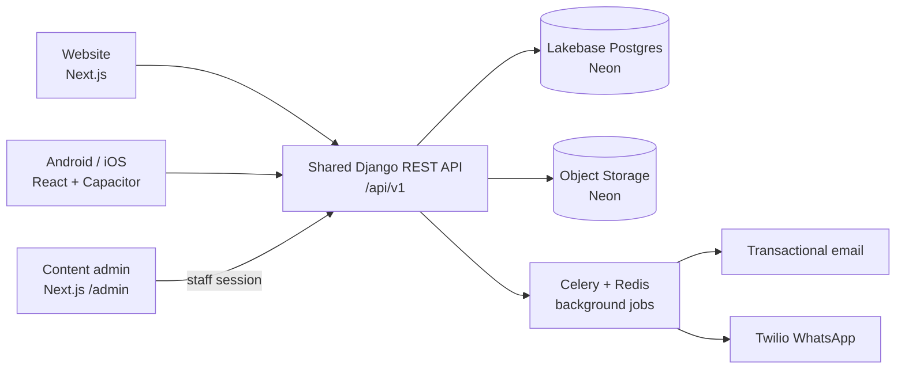
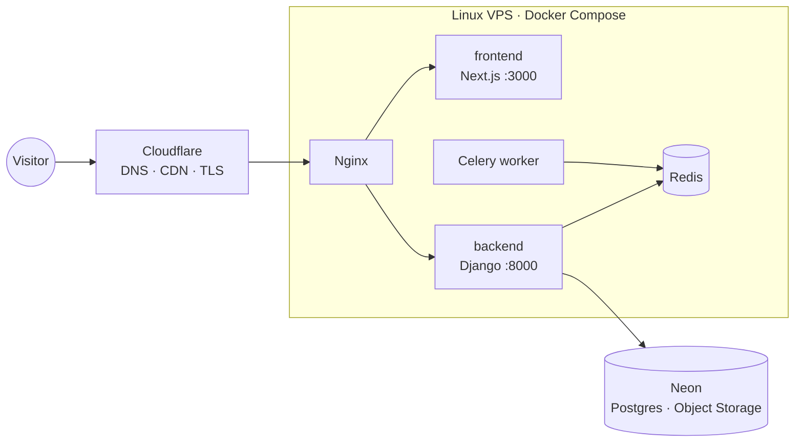
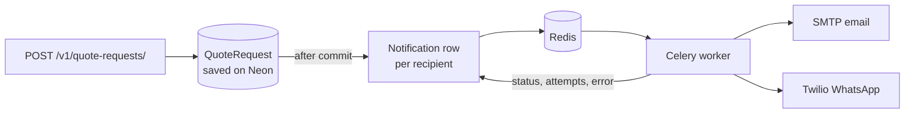
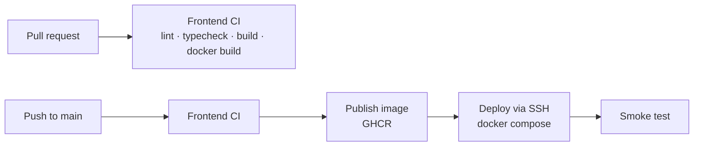

# Driveo Exclusive — Car Rental & Chauffeur Booking Platform

Driveo Exclusive Limited offers fixed-price private chauffeur travel in **London, Paris, Bulgaria and Dubai**.
This repository holds the platform that will replace the Lovable prototype. It has four parts:

- a premium, multilingual **website**
- **Android and iOS apps**
- a **shared Django API**
- an **admin dashboard**, from which the team manages vehicles, pricing, availability, customers and requests

> **Living document.** Update this README in the same change as the code it describes.
> See [Keeping this README current](#keeping-this-readme-current).
>
> **New to the project?** Start with [`project_context.md`](project_context.md). It covers the business,
> goals, plan, work objectives, progress, risks and open questions in one place.

---

## Contents

- [Project status](#project-status)
- [Repository layout](#repository-layout)
- [Architecture](#architecture)
- [Technology stack](#technology-stack)
- [Getting started](#getting-started)
- [Configuration](#configuration)
- [Domain model](#domain-model)
- [API contract](#api-contract)
- [Booking and notification workflow](#booking-and-notification-workflow)
- [Deployment](#deployment)
- [Development workflow](#development-workflow)
- [Decision log](#decision-log)
- [Open questions](#open-questions)
- [Changelog](#changelog)
- [Keeping this README current](#keeping-this-readme-current)

---

## Project status

_Last updated: 2026-10-25_

| Component | Directory | Stack | Status |
| --- | --- | --- | --- |
| Website | [`frontend/`](frontend/) | Next.js · React · TypeScript · Tailwind · GSAP | 🟡 In progress: pages complete, quote form connected to the Django API |
| Content admin | [`frontend/`](frontend/) at `/admin` | Next.js · React · TypeScript · Tailwind · TanStack Query · react-hook-form · Zod | 🟡 Full create/update/delete/reorder for services, fleet, cities and site settings in four languages. Saves to the Django API with staff sign-in when `NEXT_PUBLIC_ADMIN_CONTENT_SOURCE=api`, otherwise a browser-only demo. The website shows the published **services** (fleet, cities and settings still use built-in copy); hidden in production builds (`ADMIN_ENABLED`) |
| Shared API + admin | [`backend/`](backend/) | Python · Django · DRF · Lakebase Postgres (Neon) · Neon Object Storage · Redis · Celery | 🟡 Quote requests (with email/WhatsApp alerts), website content API with staff sign-in, health endpoint. Not deployed yet |
| Mobile apps | `mobile/` _(planned)_ | React · Vite · TypeScript · Capacitor | ⚪ Not started |
| Infrastructure | `.github/`, `infra/` _(planned)_ | Docker Compose · Nginx · Cloudflare · GitHub Actions | 🟡 Started: frontend Dockerfile and CI/CD workflows. Server and compose stack pending |
| Design reference | [`driveo-creative/`](driveo-creative/) | Lovable (TanStack Start · Supabase) | 🔒 Reference only, do not develop here |

Legend: 🟢 done · 🟡 in progress · ⚪ not started · 🔒 frozen

### Website milestones

- [x] Design ported from Lovable: hero, assurance, services, fleet, cities, process, quote, testimonial, footer
- [x] Four languages (EN, FR, BG, AR) at `/?lang=xx` URLs, with right-to-left Arabic
- [x] Inner pages: Services, Fleet, Cities, Process (same design system, each ending in the quote form)
- [x] Service detail pages (4 services × 4 languages)
- [x] SEO: metadata, hreflang, sitemap, robots, JSON-LD, web app manifest
- [x] Quote form with client validation and a typed API client (mock mode)
- [x] Quote form connected to the live Django endpoint (locally; production needs the deploy)
- [x] "Add to Home Screen" (PWA install prompt)
- [x] Production Dockerfile (standalone Next.js)
- [ ] Legal pages (privacy policy, terms, cookies)
- [ ] Analytics and consent banner
- [x] CI/CD workflows (lint, typecheck, build, Docker image to GHCR, SSH deploy)
- [ ] Automated tests (unit + end-to-end)
- [ ] Production domain, HTTPS and Cloudflare setup

---

## Repository layout

```
driveexclusive/
├── README.md            ← you are here (platform overview, living document)
├── project_context.md   ← goals, plan, objectives, progress, risks (read first)
├── .github/             ← GitHub Actions workflows (CI/CD)
├── frontend/            ← Next.js website, plus the content admin at /admin: see frontend/README.md
├── driveo-creative/     ← Lovable prototype (design + copy reference, own git repo)
├── backend/             ← Django API and admin (Celery workers planned)
│   ├── neon.ts          ← Neon services for each branch (Postgres, `assets` bucket)
│   ├── package.json     ← Neon config tooling only (`@neon/config`, `@neon/env`)
│   └── .env.local       ← backend secrets (gitignored; template `.env.example`)
├── mobile/              ← (planned) React + Capacitor Android/iOS apps
└── infra/               ← (planned) docker-compose, Nginx, deployment scripts
```

### About `driveo-creative/`

This is the original Lovable build ([GitHub](https://github.com/NHasan143/driveo-creative),
[live](https://driveo-creative-lab.lovable.app)). It is kept **only as the source of truth for design and
copy**. Do not add features there; port anything new into `frontend/`. Its Supabase quote storage and
Cloudflare deployment are replaced by the Django API and the Docker/VPS setup described below.
It keeps its own git history and is listed in the root `.gitignore`, so it is never committed here.

### Ignore rules

- [`.gitignore`](.gitignore) (root) holds platform-wide rules: secrets and `.env` files (only `.env.example`
  is committed), OS and editor files, and the build output of Node, Python/Django and Capacitor. It also
  excludes `driveo-creative/`.
- [`frontend/.gitignore`](frontend/.gitignore) holds Next.js-specific output: `.next/`, generated types,
  test reports and tool caches.
- Add a `.gitignore` inside each new app (`backend/`, `mobile/`) for anything only that app produces.

---

## Architecture

The website and the mobile apps share **one versioned backend API**. Business rules live there once:
pricing, availability, permissions and notifications.



Production runs on one Linux VPS with Docker Compose:



The database and uploaded files live on Neon (managed, branchable), not on the VPS.
This single-server setup is meant for launch; it is not a high-availability setup. Every part runs
in its own container, so the database, workers or web servers can move to separate infrastructure
later without a rewrite.

---

## Technology stack

| Area | Technology | Why |
| --- | --- | --- |
| Website | Next.js 16, React 19, TypeScript, Tailwind CSS 4, GSAP | Fast, search-friendly, premium motion; type safety |
| Mobile | React, Vite, TypeScript, Capacitor | One codebase for Android and iOS, same API contracts as the website |
| API and admin | Python, Django, Django REST Framework | Secure, proven foundation for business rules, permissions and admin |
| Data and jobs | Lakebase Postgres and Object Storage on Neon, Redis, Celery | Managed storage that branches per environment; notifications and retries run outside requests |
| Notifications | Transactional email provider, Twilio WhatsApp API | Owner alerts with delivery-failure logging |
| Hosting | Docker, Docker Compose, Linux VPS, Nginx, Cloudflare | Portable, consistent deployments with HTTPS |
| Workflow | Git, GitHub, GitHub Actions | Version control, automated tests and deployment |
| Operations | Automated backups, logging, monitoring | Recovery and visibility into application health |

Source: _Technology Stack & Deployment Architecture_ proposal (v1.0).

---

## Getting started

### Prerequisites

- Node.js **24+** and npm (website)
- Docker 24+ (container builds)
- Python 3.12+ and [uv](https://docs.astral.sh/uv/) (backend)
- Neon CLI: `npm i -g neon` (backend env vars)

### Website

```bash
cd frontend
cp .env.example .env.local
npm install
npm run dev            # http://localhost:3000 → redirects to /?lang=en
```

Useful scripts: `npm run build`, `npm run lint`, `npm run typecheck`.
The frontend has its own [README](frontend/README.md) covering code structure, conventions and the full API payload.

### Content admin

It is part of the website app: with `npm run dev` running in `frontend/`, open http://localhost:3000/admin.
By default it runs in demo mode and stores content in your browser.

To save content in Postgres instead, run the backend (below) and set `NEXT_PUBLIC_ADMIN_CONTENT_SOURCE=api` in
`frontend/.env.local`, then restart `npm run dev`. The admin asks for a sign-in: use a Django **staff** account
(`createsuperuser`, or tick "Staff status" for a user at http://localhost:8000/admin/). On an empty database,
a superuser can load the website's built-in copy from **Settings → Load the website's original content**.
Use `localhost` for both apps (not `127.0.0.1` for one of them), so the browser treats them as the same site and
sends the session cookie. See [Content admin in the frontend README](frontend/README.md#content-admin-admin).

**What the website shows.** The website's **services** come from the admin: the header's Services menu,
the home page section, the Services page, every service detail page (`/services/<slug>`) and the sitemap
read the published services from `GET /api/v1/content/published/`.
- Changes appear within about a minute; pages are cached and refresh in the background.
- A new service gets its own page on its first visit.
- If the API is unreachable, or in mock mode, the website shows its built-in copy instead.
- Fleet, cities, site settings and page headings ("Four ways to travel") still come from the website's
  built-in copy.
- A service added in the admin is not a choice in the quote form, whose four services drive the booking
  rules. Its quote buttons open the form with no service selected.

### Backend

All backend secrets live in one file, `backend/.env.local`. Its template is [`backend/.env.example`](backend/.env.example).
The Neon CLI fills in the Neon section and leaves the Django lines alone. `settings.py` contains no secrets
and won't start without `DJANGO_SECRET_KEY`.
`backend/` is linked to the Neon project `driveexclusive` (`backend/neon.ts`, `backend/.neon`), branch `production`.
Run every `neon` command from `backend/`, so the CLI finds the link and writes `backend/.env.local`.

```bash
cd backend
cp .env.example .env.local
neon env pull                                        # fills in the Neon variables
# set DJANGO_SECRET_KEY in .env.local (the template shows how to generate one)
uv venv --python 3.12 .venv
uv pip install --python .venv -r requirements.txt
.venv/Scripts/python manage.py migrate --database direct   # macOS/Linux: .venv/bin/python
.venv/Scripts/python manage.py createsuperuser       # admin login at /admin/
.venv/Scripts/python manage.py runserver             # http://localhost:8000/api/v1/health/
```

Quote alerts run in a Celery worker, so start Redis and a worker next to the server:

```bash
redis-server                                          # or: docker run -p 6379:6379 redis:7
.venv/Scripts/celery -A config worker -l info --pool=solo   # --pool=solo is needed on Windows only
.venv/Scripts/celery -A config beat -l info           # optional locally: re-queues stuck alerts every 10 min
.venv/Scripts/python manage.py test                  # all tests (they create and drop a test database on Neon, ~8 min)
```

To work without Redis, set `CELERY_TASK_ALWAYS_EAGER=true` in `.env.local`. Alerts then send inside the request.

- **Database:** `default` uses the pooled `DATABASE_URL` (PgBouncer) for app traffic. Run migrations
  with `--database direct`, which uses `DATABASE_URL_UNPOOLED`, because session-level work does not
  survive transaction pooling.
- **Files:** `default_storage` is the private Neon bucket `assets` (S3-compatible, via django-storages).
  File URLs are presigned and expire after one hour.
- **Neon services** are declared in [`backend/neon.ts`](backend/neon.ts). After changing it, run `neon deploy` from `backend/`.
- **Agent tooling:** [`.mcp.json`](.mcp.json) registers the Neon MCP server, pinned to this project, with
  OAuth. Claude Code asks you to approve it and sign in to Neon on first use. No key is stored in the repo.
- **New feature branch:** `neon checkout <name> --create` gives you a copy-on-write database and bucket
  and pulls their env vars. New non-default branches expire after 7 days. Prefer a branch such as `dev`
  for local work and migrations; `neon checkout production` switches `.env.local` back.

### Mobile

_To be added when the project is created._

---

## Configuration

Each app owns its environment template. Never commit real secrets.

| App | Template | Key variables |
| --- | --- | --- |
| Website + content admin | [`frontend/.env.example`](frontend/.env.example) | `NEXT_PUBLIC_SITE_URL`, `NEXT_PUBLIC_API_BASE_URL`, `NEXT_PUBLIC_API_MOCK`, `NEXT_PUBLIC_ADMIN_CONTENT_SOURCE` (`local` demo or `api`), `ADMIN_ENABLED` (production gate for `/admin`) |
| Backend | [`backend/.env.example`](backend/.env.example) → `backend/.env.local` (Neon section filled in by `neon env pull`) | `DJANGO_SECRET_KEY`, `DJANGO_DEBUG`, `DJANGO_ALLOWED_HOSTS`; Neon: `DATABASE_URL`, `DATABASE_URL_UNPOOLED`, `AWS_*`; jobs: `REDIS_URL`; alerts: `QUOTE_ALERT_EMAILS`, `QUOTE_ALERT_WHATSAPP`, `SMTP_*`, `DEFAULT_FROM_EMAIL`, `TWILIO_*`, `BACKEND_BASE_URL` (also the base of content photo URLs); browser access: `CORS_ALLOWED_ORIGINS`, `CSRF_TRUSTED_ORIGINS`, `SESSION_COOKIE_SAMESITE`, `STAFF_SIGN_IN_RATE` |

With no API URL set, the website runs in **mock mode**: quote requests get a fake `DRV-XXXXXX` reference.
This lets you work on the frontend without the backend.

---

## Domain model

The website and the API use the same **stable ids**. Labels are translated per language and are never
sent to the API.

| Concept | Ids |
| --- | --- |
| City | `london` · `paris` · `bulgaria` · `dubai` |
| Service | `airport_transfer` · `point_to_point` · `hourly_hire` · `private_event` |
| Vehicle class | `business_class` (E-Class) · `first_class` (S-Class) · `business_van` (VLE) · `please_advise` |

Business rules currently enforced on the client (the API must enforce them too):

- **Capacity:** `business_van` takes up to 7 passengers and 8 luggage items. Every other class takes 4 and 3.
- **Hourly hire:** 2–16 hours. No destination is required. Each hour includes 15 miles within Greater London.
- **Supported languages:** `en`, `fr`, `bg`, `ar` (Arabic is right-to-left).

Frontend source of truth: [`frontend/src/domain/booking.ts`](frontend/src/domain/booking.ts).

---

## API contract

Base URL: `{API_BASE_URL}/v1/`. JSON, snake_case. Every client sends `Accept-Language`.

| Endpoint | Method | Used by | Status |
| --- | --- | --- | --- |
| `/v1/health/` | `GET` | Uptime checks, deploys | Implemented: `200 {"database":"ok","storage":"ok"}`, or `503` if either fails |
| `/v1/quote-requests/` | `POST` | Website quote form | Implemented and used by the website |

`POST /v1/quote-requests/` returns `201 { "reference": "DRV-XXXXXX" }`.
The full request body, the validation rules and the honeypot (anti-spam) field are in the
[frontend README](frontend/README.md#backend-contract). The API enforces the same rules. It also
rejects journey dates more than one day in the past.

- **Errors:** `400` with DRF field errors, for example `{"passengers": ["This vehicle takes up to 4 passengers."]}`.
- **Honeypot:** a filled honeypot gets a normal-looking `201` with a fake reference. Nothing is stored or sent.
- **Rate limit:** `QUOTE_REQUESTS_RATE` per IP (default `10/hour`), then `429`.
- **References:** `DRV-` plus 6 characters, without 0/O/1/I so they are easy to read out.

### Content API (`backend/content/`)

Backs the content admin at `/admin`. Unlike the booking API, its JSON is **camelCase** and matches the
admin's types one to one ([`types.ts`](frontend/src/admin/lib/content/types.ts)), so records go to the
forms without mapping. Every endpoint is staff-only unless marked public.

| Endpoint | Method | Purpose |
| --- | --- | --- |
| `/v1/auth/csrf/` | `GET` | Public. `{"csrfToken"}` plus the `csrftoken` cookie |
| `/v1/auth/session/` | `GET` · `POST` · `DELETE` | Who is signed in (`403` if nobody) · sign in `{"username", "password"}` (username or email; staff only; `STAFF_SIGN_IN_RATE`) · sign out |
| `/v1/content/{services,vehicles,cities}/` | `GET` · `POST` | List (drafts included, by `order`) · create (goes last) |
| `/v1/content/{collection}/{id}/` | `GET` · `PUT` · `DELETE` | Read · replace · delete (references to it are removed) |
| `/v1/content/{collection}/reorder/` | `POST` | `{"ids": [...]}` in display order → `204` |
| `/v1/content/settings/` | `GET` · `PUT` | Site settings (company, contacts, social links, testimonials) |
| `/v1/content/snapshot/` | `GET` | Everything: `{services, vehicles, cities, settings}` |
| `/v1/content/import/` | `POST` | Superusers only. Replaces all content with a snapshot, keeping ids (the admin's "Load the website's original content") |
| `/v1/content/images/` | `POST` | Multipart `file` (JPG, PNG or WebP, ≤ 12 MB) → `201 {"url"}` |
| `/v1/content/images/{name}` | `GET` | Public. Redirects to a fresh presigned link in the `assets` bucket |
| `/v1/content/published/` | `GET` | Public. Published records only. The website reads its services from it |

- **Sign-in:** Django session cookie (HttpOnly) plus CSRF token, the same as Django's admin. The admin calls
  with `credentials: "include"`, reads the CSRF token from JSON (it can't read the API's cookies) and sends it
  as `X-CSRFToken`. The website's origin must be in `CORS_ALLOWED_ORIGINS` (and so in `CSRF_TRUSTED_ORIGINS`).
  The website and API must share a site (for example `driveoexclusive.com` and `api.driveoexclusive.com`, or
  the API under `/api` on the same domain) for the cookie to be sent.
- **Errors:** `400` with field errors keyed by the form's field paths, for example
  `{"slug": ["The URL slug \"london\" is already used by another entry."]}` or
  `{"facts": {"0": {"value": {"en": ["Keep this under 16 characters."]}}}}`. Limits match the admin's Zod schemas.
- **Translations:** each text field is `{"en", "fr", "bg", "ar"}`; English is required except for SEO fields.
- **Slugs** are unique per collection. **Ids** are strings; imported records keep theirs (`airport_transfer`).
- **Photos:** a record stores a website path (`/media/…`) or the bucket key of an upload, and the API returns
  the key as a stable `/v1/content/images/…` URL. Data URLs are refused; the admin uploads photos before saving.

> When the backend is created, publish its OpenAPI schema (for example, drf-spectacular at `/api/schema/`)
> and link it here. That schema then becomes the source of truth for this table.

---

## Booking and notification workflow

1. **Request submitted.** A customer sends a booking or quote request from the website or app.
2. **Validated and saved.** The API checks details, availability and pricing rules, then stores the request.
3. **Notification queued.** A Celery task is created, so the customer gets a confirmation right away.
4. **Owner alerted.** The owner receives the request by email and Twilio WhatsApp and handles it in the dashboard.

Every request is **saved before any notification is sent**. If a provider is down, the failure is logged
and the send is retried automatically. A saved booking is never lost because a message failed.

### How it's built (quote requests, `backend/quotes/`)



- **One `Notification` row per recipient and channel**, shown inline on the request in the admin
  (pending, sent, failed or skipped, with attempt count and last error).
- **Retries:** after 1, 2, 4, 8 and 16 minutes for outages, timeouts and rate limits (Twilio 429/5xx,
  SMTP connection errors). Permanent errors (an invalid number, rejected credentials) fail at once.
- **Redis down when a request arrives:** the request is still saved and its rows stay pending. Celery beat
  re-queues pending rows older than 45 minutes every 10 minutes.
- **Missing configuration** (no recipients, no Twilio credentials) creates a `skipped` row with the reason,
  never a silent gap.
- **Admin:** staff can filter and search requests, set a status (new, contacted, quoted, closed), keep
  staff notes, and use the **Resend failed alerts** action.
- **Email** has a text and an HTML part and a link to the request in the admin. Without `SMTP_HOST`,
  it is printed to the console.

### Replies are manual

The customer gets no automatic message. The website shows their reference and says a concierge will
be in touch. The owner replies personally, and every alert is built for that:

- **Email alert:**
  - The sender shows as "Ada Lovelace via Driveo Exclusive", and `Reply-To` is the customer, so
    pressing Reply answers them directly.
  - It has **Reply by email**, **Reply on WhatsApp** (a `wa.me` chat link) and **Call** buttons.
- **WhatsApp alert:** it ends with the customer's `wa.me` link and email. Replying in the alert chat
  itself goes to the Twilio number, not the customer, and the message says so.
- **Admin:** each request has the same reply links. Set the status to *Contacted* after replying.
- **WhatsApp links need an international number** (starting with `+` or `00`). A local number such as
  `020 7946 0000` gets email and phone options only.

### WhatsApp (Twilio)

1. **Testing:** use the [Twilio WhatsApp sandbox](https://www.twilio.com/docs/whatsapp/sandbox).
   - Set `TWILIO_WHATSAPP_FROM=+14155238886` and leave `TWILIO_WHATSAPP_CONTENT_SID` empty.
   - Each recipient joins the sandbox from their phone first.
2. **Production:** WhatsApp only delivers free-form messages within 24 hours of the recipient's last message.
   Business-initiated alerts need an **approved template**.
   - Create one in Twilio Content Template Builder with seven placeholders, in this order:
     `{{1}}` reference, `{{2}}` service and city, `{{3}}` date and time, `{{4}}` route, `{{5}}` customer
     name, phone and email, `{{6}}` dashboard link, `{{7}}` the customer's WhatsApp link (or phone number).
   - Put its `HX...` SID in `TWILIO_WHATSAPP_CONTENT_SID`.
   - Set `TWILIO_WHATSAPP_FROM` to the business's WhatsApp-enabled sender.

---

## Deployment

| Environment | URL | How |
| --- | --- | --- |
| Local | http://localhost:3000 | `npm run dev` |
| Staging | _not set up_ | — |
| Production | _not set up_ | Docker Compose on VPS behind Nginx and Cloudflare |

Website image (see the [Dockerfile](frontend/Dockerfile)):

```bash
cd frontend
docker build -t driveo-frontend \
  --build-arg NEXT_PUBLIC_SITE_URL=https://driveoexclusive.com \
  --build-arg NEXT_PUBLIC_API_BASE_URL=https://driveoexclusive.com/api .
docker run -p 3000:3000 driveo-frontend
```

`NEXT_PUBLIC_*` values are baked in at build time, so build a separate image for each environment.

### CI/CD (GitHub Actions)

| Workflow | Trigger | What it does |
| --- | --- | --- |
| [`frontend-ci.yml`](.github/workflows/frontend-ci.yml) | PRs touching `frontend/`, manual, or called by deploy | `npm ci` → lint → typecheck → production build. On PRs it also checks that the Docker image builds |
| [`frontend-deploy.yml`](.github/workflows/frontend-deploy.yml) | Push to `main` touching `frontend/`, or manual (choose environment) | Runs CI → builds and pushes `ghcr.io/<owner>/driveo-frontend` (tags `sha-<commit>` and `<environment>`) → SSH to the VPS → `docker compose pull/up frontend` → smoke test |



**Safety rails built into the pipeline**

- Deployments to an environment run one at a time; a running deploy is never cancelled.
- If `NEXT_PUBLIC_API_BASE_URL` is missing, the image is built in mock mode and **deployment is refused**,
  unless that environment sets `ALLOW_MOCK_DEPLOY=true` (for preview environments only).
- Until `DEPLOY_HOST` is configured, the image is still published but the deploy job is skipped with a notice.
- The server is reached with a dedicated SSH key, and host keys are pinned (`DEPLOY_KNOWN_HOSTS`).

**One-time GitHub setup**

1. **Environments:** create `production` (and optionally `staging`) under *Settings → Environments*.
   Add required reviewers on `production` if releases need approval.

   | Kind | Name | Example |
   | --- | --- | --- |
   | Variable | `NEXT_PUBLIC_SITE_URL` | `https://driveoexclusive.com` |
   | Variable | `NEXT_PUBLIC_API_BASE_URL` | `https://driveoexclusive.com/api` |
   | Variable | `DEPLOY_PATH` | `/opt/driveo` |
   | Variable | `ALLOW_MOCK_DEPLOY` | `true` (staging previews only) |
   | Secret | `DEPLOY_HOST` | `203.0.113.10` |
   | Secret | `DEPLOY_USER` | `deploy` |
   | Secret | `DEPLOY_SSH_KEY` | private key of a deploy-only key pair |
   | Secret | `DEPLOY_KNOWN_HOSTS` | output of `ssh-keyscan -H <host>` |
   | Secret | `DEPLOY_PORT` | optional, default `22` |

2. **Branch protection** on `main`: require pull requests and the status check
   **"Frontend CI / Lint, typecheck & build"** to pass.
3. **Server:** install Docker with the Compose plugin, add the deploy user to the `docker` group, and put
   a `docker-compose.yml` in `DEPLOY_PATH` with a `frontend` service that reads the image from
   `FRONTEND_IMAGE`:

   ```yaml
   services:
     frontend:
       image: ${FRONTEND_IMAGE:-ghcr.io/<owner>/driveo-frontend:production}
       restart: unless-stopped
       expose: ["3000"]
   ```

   The full compose stack (Nginx, Django, PostgreSQL, Redis) will live in `infra/`.

**Convention for new apps:** add `<app>-ci.yml` (PR checks, reusable via `workflow_call`) and
`<app>-deploy.yml`, and filter both on the app's folder with `paths`.

**Dependency updates are manual.** Dependabot was removed on 2026-10-24. Check for updates about once a
month with `npm outdated` in `frontend/`. Update deliberately, then run lint, typecheck and build before
merging. Even-numbered Node LTS releases are the only ones to adopt.

---

## Development workflow

- **Branches:** `main` is always deployable. Work on `feature/<short-name>` or `fix/<short-name>` and merge through a pull request.
- **Commits:** Use [Conventional Commits](https://www.conventionalcommits.org/), for example `feat(frontend): add privacy page`.
  Scopes: `frontend`, `backend`, `mobile`, `infra`, `docs`.
- **Before a PR:** in `frontend/`, run `npm run lint && npm run typecheck && npm run build`.
- **CI/CD:** GitHub Actions checks every PR and deploys `main` (see [CI/CD](#cicd-github-actions)). Add tests to the CI workflow as they are written.
- **Design changes:** agree them against the Lovable reference first, then implement them in `frontend/`.

---

## Decision log

Record decisions that would surprise a newcomer. Add new entries at the top.

| Date | Decision | Reason |
| --- | --- | --- |
| 2026-10-26 | Content admin signs staff in with Django's session cookie + CSRF token, not an API token | The cookie is HttpOnly, so no script on the page (or XSS) can steal a credential; sign-out and deactivating a user take effect at once; it reuses Django's users, `is_staff` and password hashing. Cost: the website and API must share a site, and the CSRF token travels in JSON. DRF now denies by default (`IsAdminUser`); public views opt out |
| 2026-10-26 | Translated content stored as one JSON object per field (`{"en","fr","bg","ar"}`), not a column per language | Matches the admin's types; repeatable parts (facts, features, steps) are lists of translated objects that columns can't express; adding a language needs no migration. Serializers validate keys and lengths |
| 2026-10-26 | Content photos stored as references (website path or bucket key) served through a redirect endpoint | The bucket is private and presigned links expire after an hour, so they can't be saved in records. One stable URL per photo works in the admin and, later, on the website |
| 2026-10-26 | Content admin lives in the website app at `/admin` (its own root layout), not a separate app. Production hides it unless `ADMIN_ENABLED=true` | Client preference: one app to run and deploy. A second root layout keeps admin code and CSS off website pages. The gate stops an unauthenticated admin from going live with the site |
| 2026-10-25 | Content admin built first against a browser-local store behind a `ContentRepository` interface | The client asked for the admin frontend first. Screens never touch storage directly, so connecting the Django API means swapping one implementation. Django's built-in admin stays for staff operations (quote requests) |
| 2026-10-24 | Postgres and uploaded files on Neon (Lakebase Postgres + Object Storage) instead of containers on the VPS | Managed backups and scale-to-zero; database and files branch together for dev/preview; one fewer stateful service on the VPS |
| 2026-10-22 | CI/CD on GitHub Actions: images in GHCR, deploy over SSH with `docker compose` | No extra services to pay for; matches the Docker/VPS plan; the pipeline refuses mock-mode deploys |
| 2026-10-22 | Website rebuilt in Next.js instead of extending the Lovable (TanStack Start) code | Matches the agreed stack; better SEO and long-term maintainability |
| 2026-10-24 | Removed Dependabot; dependency updates are manual | Too many automated PRs for the team's size, some unsuitable (non-LTS Node, unsupported TypeScript major) |
| 2026-10-23 | Language is a query parameter (`/?lang=en`) in public URLs, replacing `/en` paths | Client preference. Each language is still prerendered (the proxy rewrites internally) and indexable via hreflang/canonical. Old `/en` links redirect |
| 2026-10-22 | Language in the URL instead of a client-side switch only (first as `/en` paths) | Each language can be indexed by search engines, with hreflang |
| 2026-10-22 | API values are stable snake_case ids; labels live in dictionaries | Renaming or translating labels never breaks stored data |
| 2026-10-22 | Quote form posts to the Django API; Supabase from the prototype is dropped | One shared backend for web, mobile and admin |
| 2026-10-22 | Frontend runs in mock mode until the API is ready | Frontend and backend can be built in parallel |

---

## Open questions

- [ ] Quote notification recipients: the prototype sent email only, to `driveolimited@gmail.com`. The proposal specifies email and Twilio WhatsApp. Confirm the address and WhatsApp number.
- [ ] Production domain and hosting provider for the VPS.
- [ ] Transactional email provider (for example Postmark, SES or Resend) and the sender domain.
- [ ] Are customer accounts needed in v1, or only anonymous quote requests?
- [ ] Copy for the legal pages (privacy, terms, cookies) and the cookie-consent approach.
- [ ] Whether to keep the hourly-hire note ("15 miles within Greater London") for the other cities.

---

## Changelog

Newest first. Follow [Keep a Changelog](https://keepachangelog.com/) headings: Added / Changed / Fixed / Removed.

### 2026-10-25

**Added**
- `frontend`: content admin at `/admin` for the website's services, fleet, cities and site settings
  (contact details, social links, testimonials).
  - Create, edit, duplicate, publish/unpublish, reorder and delete, with confirmation and reference cleanup.
  - Every text field has EN, FR, BG and AR versions. A language switcher shows completeness per language,
    and Arabic fields are right-to-left.
  - Validation messages that jump to the problem field.
  - Image upload with compression, or a pick from the photo library.
  - A Google-style SEO preview.
  - A dashboard with counts, translation progress and a "Needs attention" list.
  - Light and dark themes, and a phone layout with a slide-out menu.
  - Demo mode: content lives in the browser (IndexedDB), seeded from the website's dictionaries by
    the website's own dictionaries. It is not connected to the API or the website yet.
  - It lives in the website app with its own root layout. Production builds answer 404 at `/admin`
    unless `ADMIN_ENABLED=true`.

**Added**
- `backend`: quote request system (`quotes` app).
  - `POST /api/v1/quote-requests/` validates the website's rules, drops honeypot submissions silently,
    rate-limits per IP and returns `201 {reference}`.
  - Owner alerts by email (SMTP) and Twilio WhatsApp run through Celery + Redis, with retries,
    a delivery log per recipient, and a periodic sweep for alerts that were never queued.
  - Admin pages for requests and alerts, including a "Resend failed alerts" action.
  - 27 tests at the time.

### 2026-10-27

**Fixed**
- A service added in the content admin was saved only in the browser and never reached the website.
  - Locally the admin now saves through the API (`NEXT_PUBLIC_ADMIN_CONTENT_SOURCE=api` in `frontend/.env.local`).
  - The website's services menu, home section, Services page, detail pages and sitemap read the published
    services from the API (`frontend/src/lib/content/site-services.ts`), cached for about a minute, with the
    built-in copy as fallback. New services get detail pages without a rebuild.
  - Uploaded photos are shown as-is.
  - The Services gallery fits up to five services in one row.

### 2026-10-26

**Added**
- `backend` + `frontend`: the content admin saves to Postgres through a new Django `content` app.
  - Models for services, vehicles, cities and site settings, with translations as JSON per field, `order`,
    `published`, slugs unique per collection, and ordered vehicle links per service.
  - DRF endpoints under `/api/v1/content/` for every admin operation (list, get, create, update, delete,
    reorder, settings, snapshot, import) plus photo upload to the Neon `assets` bucket and a public
    `published/` endpoint for the website. `400` errors point at the form field.
  - Staff sign-in (`/api/v1/auth/`): session cookie + CSRF token, rate limited, staff accounts only.
    DRF now requires staff by default; the quote form and health check stay public.
  - `frontend/src/admin/lib/content/api-repository.ts`, switched on with `NEXT_PUBLIC_ADMIN_CONTENT_SOURCE=api`.
    The admin then shows a sign-in screen and a Sign out button; demo mode is unchanged.
  - 40 new backend tests (69 in total).
- `frontend` + `backend`: the website's quote form talks to the Django API (`NEXT_PUBLIC_API_MOCK=false`).
  The backend allows the website's origin with django-cors-headers (`CORS_ALLOWED_ORIGINS`).
- `frontend`: clearer form errors in all four languages:
  - which fields the API rejected;
  - a "too many requests" message for the API's 429 and for the form's own 30-second cooldown, which
    used to ignore the click silently.
- `backend`: alerts are built for manual replies. The email shows the customer's name as the sender
  and has Reply by email, Reply on WhatsApp and Call buttons. The WhatsApp alert has the customer's
  `wa.me` link. The admin shows the same reply links. Two new tests (29).

**Changed**
- `frontend/.env.example` now defaults to the real API. Set `NEXT_PUBLIC_API_MOCK=true` to work without the backend.
- The WhatsApp template has a seventh placeholder: the customer's WhatsApp link.

**Added**
- `backend`: Django 6.1 project connected to Neon. It uses Lakebase Postgres through psycopg 3
  (pooled for app traffic, direct for migrations) and the private `assets` bucket as the default
  file storage (django-storages S3). It also adds `GET /api/v1/health/` for both services, plus
  `requirements.txt` and `.env.example`. All secrets, including `DJANGO_SECRET_KEY`, are read from
  `backend/.env.local`; `settings.py` has no fallback secret key, and `DEBUG` defaults to off.
- `infra`: `backend/` is linked to the Neon project `driveexclusive`. `backend/neon.ts` declares the services,
  and `backend/package.json` holds the Neon config tooling.
- `infra`: project-level Neon MCP server in `.mcp.json` (OAuth, pinned to `icy-block-59285110`).
- `frontend`: service detail pages for Airport transfer, Point-to-point, Hourly hire and Private events
  (`/services/<slug>?lang=xx`), in all four languages. Their sections are:
  - a hero with an "At a glance" card;
  - a key-facts strip;
  - an overview with features and a photo;
  - service-specific steps;
  - recommended vehicles (pre-filling service and car);
  - the testimonial, links to the other services, and the quote form, pre-filled with the service.

  The header dropdown, the Services page and the homepage cards link to them, and the sitemap now has 36 URLs.
- `frontend`: Services dropdown in the header. It lists the four services with icons, each deep-linking
  to its row on the Services page, plus an "All services" link. It opens on hover with a mouse and on
  tap or keyboard otherwise.

**Fixed**
- `frontend`: on phones the second row of nav links wrapped onto two lines in Bulgarian (and in French at 320px).
  That made the header taller, and on the homepage it covered the logo by 10px. The row now always stays on one
  line: type and spacing scale with the screen width. Verified at 320–1000px in all four languages
  (header 126px, hero content ≥ 34px below it).
- `frontend`: header buttons and layout.
  - The language switcher and "Request quote" are now the same height and style.
  - At 1024–1279px the nav links stay on the second row. In Bulgarian the company name had wrapped
    and overlapped the nav.
  - Phones show the logo without the name text, which was being squeezed to a few letters.
  - Bulgarian mono labels use IBM Plex Mono instead of a heavy system font.
  - Verified at 320–1440px in all four languages: equal 39px buttons and no overlaps.

**Removed**
- Dependabot (`.github/dependabot.yml`). Dependency updates are now checked manually (see [CI/CD](#cicd-github-actions)).

### 2026-10-23

**Added**
- `frontend`: Services, Fleet, Cities and Process pages (`/services?lang=xx` …) in all four languages. Each has:
  - a compact page hero (parallax, breadcrumb, quote CTA);
  - its own content: per-service inclusions; fleet showcase and comparison table; a city directory;
    a booking timeline and checklist;
  - the quote form at the end.
- `frontend`: "Quote this service / car / journey here" buttons pre-fill the service, vehicle or city in the form.
- `frontend`: header page links with an active state (a second row on phones). The footer has "Explore"
  and city links, and the home sections link to the full pages. The sitemap covers all 20 page URLs.

**Changed**
- `frontend`: the language switcher is now a custom dropdown. It lists English, Français, Български and
  العربية in their own scripts, matches the button's width and style, and shows the short code
  (EN/FR/BG/AR) on phones.
- `frontend`: public URLs now carry the language as `/?lang=en|fr|bg|ar`. Bare `/`, old `/en`-style links
  and invalid values redirect there, and the choice is saved in a cookie. SEO canonical/hreflang tags and
  the sitemap use the new URLs.

**Fixed**
- `frontend`: pinned `turbopack.root` so a stray lockfile in a parent folder can't change the workspace root.

### 2026-10-22

**Added**
- `frontend/`: Next.js 16 website ported from the Lovable design, with every section, four languages,
  RTL support, GSAP scroll motion and 3D parallax.
- Quote form with Zod validation, vehicle capacity rules, a honeypot field and a typed API client with mock mode.
- SEO metadata, hreflang, sitemap, robots, JSON-LD, web manifest and the PWA install prompt.
- Production Dockerfile (standalone output, non-root user).
- This README.
- Root `.gitignore` (platform-wide rules, prepared for the backend and mobile apps) and a rewritten `frontend/.gitignore`.
- `project_context.md`: project brief, roadmap, work objectives, progress, risks and open questions.
- GitHub Actions: `frontend-ci.yml` (PR quality gate), `frontend-deploy.yml` (GHCR image and SSH deploy
  with safety rails), Dependabot config, and `frontend/.nvmrc` pinning Node 24.

---

## Keeping this README current

Update this file **in the same pull request** as the change. A quick checklist:

| When you… | Update |
| --- | --- |
| Finish or start a component or milestone | [Project status](#project-status) and its "Last updated" date |
| Add an app or top-level folder | [Repository layout](#repository-layout) |
| Add, rename or remove an env variable | [Configuration](#configuration) and that app's `.env.example` |
| Add or change an endpoint | [API contract](#api-contract) |
| Change a city, service, vehicle or rule | [Domain model](#domain-model) and `frontend/src/domain/booking.ts` |
| Make a non-obvious technical choice | [Decision log](#decision-log) |
| Answer an open question | Tick it in [Open questions](#open-questions) and record the outcome in the Decision log |
| Merge user-visible work | [Changelog](#changelog) |
| Change plan, progress, objectives or risks | [`project_context.md`](project_context.md) (§7–§12) |

App-level details (code structure, conventions, scripts) belong in that app's own README, such as
[`frontend/README.md`](frontend/README.md). This file stays a platform overview.
